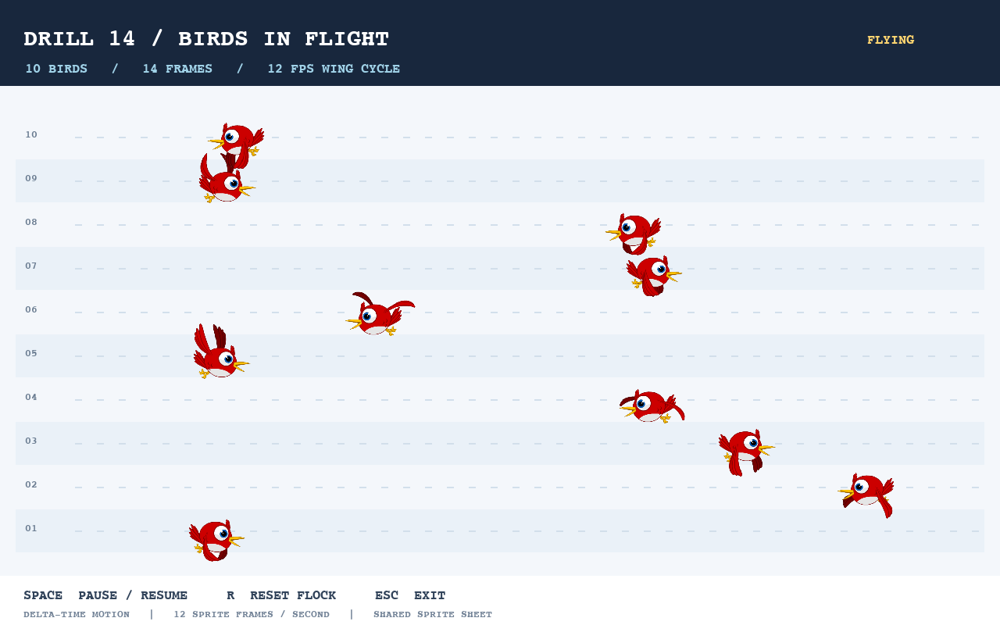
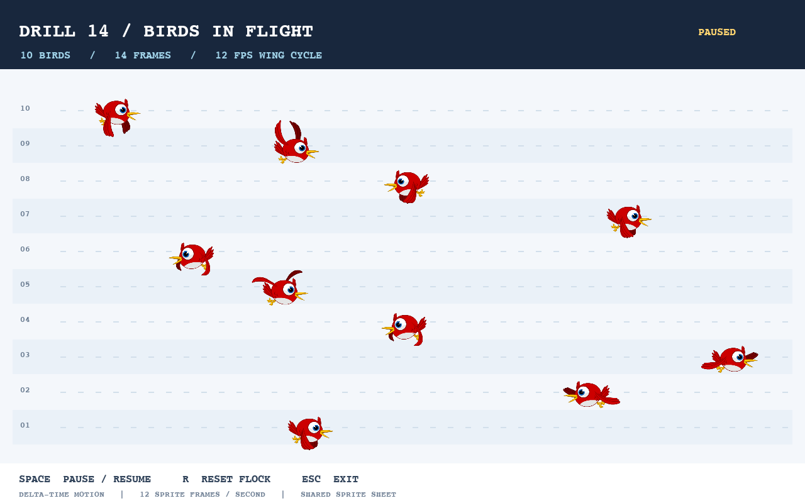

# Drill-14 · 새 10마리의 비행 애니메이션

제공된 `bird_animation.png`의 14프레임을 사용해 새 10마리가 좌우로 계속 비행한다. 새마다 시작 위치·방향·속도·날갯짓 위상이 다르며, 이동과 애니메이션 모두 실제 경과 시간에 비례한다.



## 실행

Python 3이 설치된 Windows에서 실행한다. Python 3.14와 실제 pico2d 창으로 검증했다.

```powershell
git clone https://github.com/Rito0114/Drill-14.git
cd Drill-14
python -m pip install -r requirements.txt
python main.py
```

`python` 대신 `py`를 쓰는 환경에서는 위 명령의 `python`을 `py`로 바꾸면 된다. VS Code에서는 `main.py`를 열고 Python 파일 실행 버튼을 누른다. 이미지와 폰트는 코드 파일 위치를 기준으로 읽으므로 다른 폴더에서 실행해도 된다.

| 키 | 동작 |
| --- | --- |
| SPACE | 새 10마리의 이동과 날갯짓 일시 정지/재개 |
| R | 새 10마리의 위치·속도·위상 재설정 |
| ESC 또는 창 닫기 | 자원 정리 후 종료 |

## 정확한 비행 애니메이션 구현 원리

1. **실제 스프라이트 간격 확인:** 원본은 918×506이다. 불투명 픽셀의 분포를 확인하면 새의 기준 위치는 가로 182픽셀 간격이며 행은 위쪽 기준 0/170/340에서 시작한다. 우측 8픽셀은 여백이다. 전체 크기를 단순히 5×3으로 등분하면 이웃 새의 날개나 꼬리가 섞인다. 마지막 행 높이는 이미지 끝에 맞춰 166픽셀로 자른다.
2. **14칸만 순서대로 재생:** `row, column = divmod(frame, 5)`로 행 우선 순서를 구한다. 프레임 번호를 0~13으로 제한하여 셋째 행 마지막 빈 칸은 사용하지 않는다. 이미지 상단 기준 행 좌표를 pico2d 하단 원점에 맞게 `image.h - bottom`으로 변환한다.
3. **날갯짓 속도 고정:** `phase = (phase + 12 × frame_time) % 14`로 위상을 갱신한다. 정수 부분을 그릴 프레임 번호로 사용한다. 초당 12프레임이므로 전체 날갯짓 주기는 `14 / 12 ≈ 1.167초`다. 화면 FPS가 바뀌어도 주기는 유지된다.
4. **실제 시간 기반 이동:** 각 새의 속도는 초당 140~230픽셀이다. 이동량은 `speed × frame_time`으로 계산한다. 프레임당 고정 픽셀을 더하지 않는다. 경과 시간은 `time.perf_counter()`로 업데이트 전에 측정한다.
5. **경계의 초과 이동 보존:** 좌우 이동 구간 길이를 L이라 할 때 왕복 거리를 2L 주기로 누적한 뒤 접는다. 오른쪽 구간이면 왼쪽으로, 왼쪽 구간이면 오른쪽으로 움직인다. 큰 시간 간격으로 경계를 여러 번 넘어도 초과 이동량이 사라지지 않는다. 스프라이트 반너비를 고려한 구간을 사용하고 왼쪽 비행에는 수평 반전을 적용한다.
6. **자원 공유와 정지:** 새 10마리가 한 장의 이미지를 공유한다. 정지 중에는 새 업데이트만 멈추고 프레임 시간 측정은 계속해서 재개할 때 위치가 뛰지 않는다. `finally`에서 모드와 캔버스를 정리한다.

## 검증

```powershell
python -m unittest -v
python verify_render.py
```

- 자동 검증 **7개 통과**: 30/60/144fps에서 10초 후 위치·방향·날갯짓 위상 동일, 좌우 반사의 초과 거리 보존, 큰 시간 간격의 여러 번 반사, 정확한 주기 순환, 14프레임 및 자르기 좌표, 0초 업데이트, 좌우 반전.
- 실제 SDL 창 검증 **통과**: 새 10마리 출력, 화면 밖 잘림 방지, SPACE 정지/재개, R 재배치, ESC 종료, 이미지와 객체 정리.
- 저장소 바깥 작업 폴더에서 실행한 실제 검증도 통과했다.
- 화면을 직접 확인하며 프레임 경계의 픽셀 혼입을 수정했다. `verify_render.py`는 약 1.5초 동안 실행한 뒤 종료하며 `screenshots/flight.png`, `screenshots/paused.png`를 갱신한다.



## 파일 구성

| 파일 | 역할 |
| --- | --- |
| `main.py` | 실행 및 캔버스 생성/종료 |
| `game_framework.py` | 경과 시간 기반 게임 루프 |
| `play_mode.py` | 새 10마리 생성, 공용 이미지 로딩, 화면과 입력 |
| `bird.py` | 비행 모델, 프레임 계산, 좌표 변환, 좌우 반전 |
| `bird_animation.png` | 제공된 새 스프라이트 원본 |
| `ENCR10B.TTF` | 화면 안내용 폰트 |
| `PRD.md` | 개발 기획·요구사항·검증 계획 |
| `test_bird.py`, `verify_render.py` | 자동 검증 및 실제 창 검증 |

## 개발 이력 및 제출

기획 → 비행 모델과 자료 추가 → 실제 게임 화면 → 검증과 행 보정 → 열 간격 보정 → 실행 안내와 결과 정리 순서로 실제 작업 내용을 한국어 커밋에 남겼다. 최종 커밋 본문에 구현 원리와 검증 결과를 상세히 기록한다. 과거 날짜로 이력을 만들지 않는다.

- 공개 저장소: <https://github.com/Rito0114/Drill-14>
- e-Class 제출 주소: **`https://github.com/Rito0114/Drill-14.git`**
- 과목/과제: 2D게임프로그래밍 / Drill-14
- 사용자 안내 마감: 2026년 11월 11일 17시 20분(한국 시간)

AI를 활용해 기획, 코드 구현, 검증을 진행했다. 이미지와 폰트의 출처는 수업 저장소 `unreal-class/2026-2DGP`의 `Labs/LEC16_Time`이며, 제공된 원본을 그대로 포함했다.
